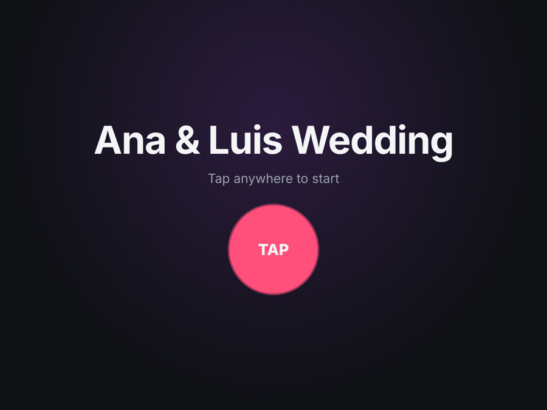
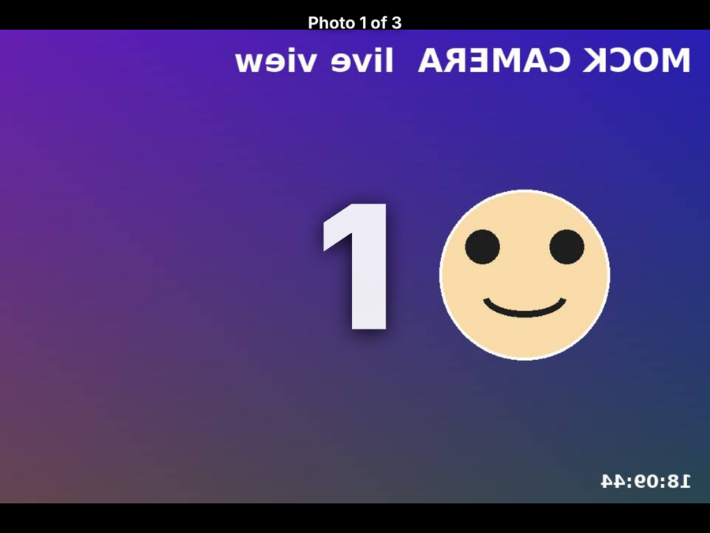
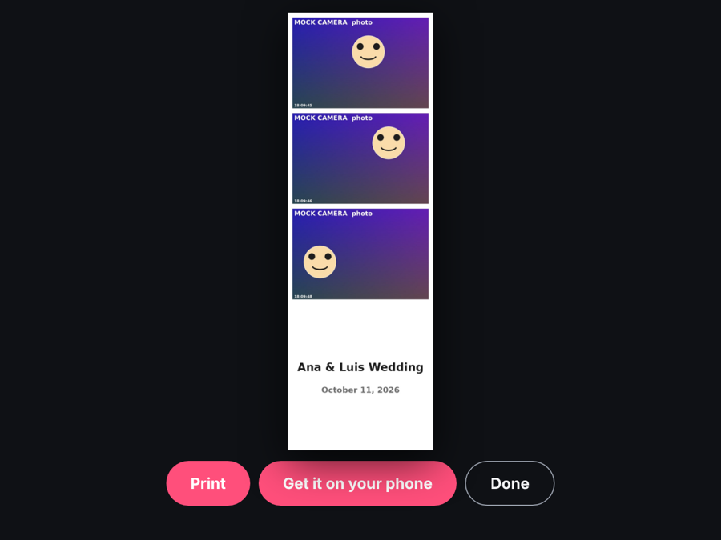
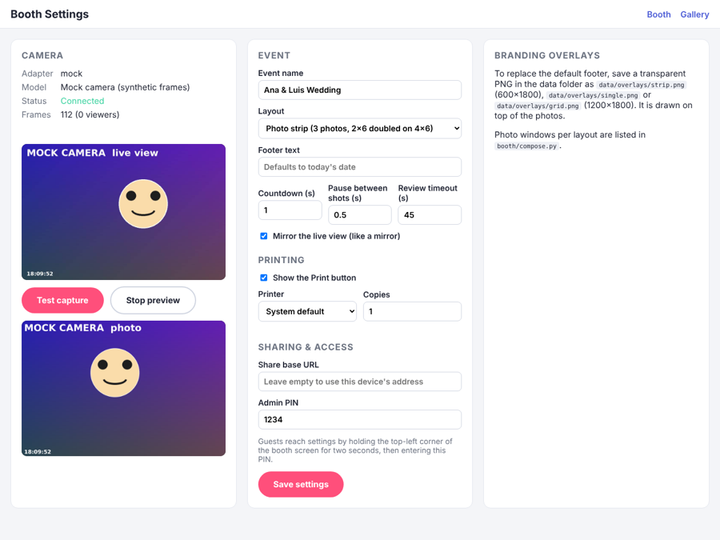

# Photo Booth

Self-hosted photo booth for weddings, quinceañeras and parties. A Canon DSLR
streams live view to a full-screen touch UI; guests tap, pose through a
countdown, and get a printed strip plus a QR code to download their photo.
Runs on a Windows PC (Canon EDSDK) or on Linux/macOS (libgphoto2).

| Attract | Live view + countdown |
| --- | --- |
|  |  |

| Review | Settings |
| --- | --- |
|  |  |

## Try it in your browser

The UI is published to GitHub Pages as a demo:
**https://angelz177.github.io/photo-booth/**

There is no camera service on Pages, so the page runs in **demo mode**: live
view and capture use your device's camera, strips are composed in the browser
with the same layouts the service prints, settings live in your browser, and
finished photos appear in the gallery on the same device. "Save photo"
downloads the strip and "Print" opens the browser's print dialog. The real
booth service replaces all of that with the Canon and the DNP printer; the
pages are identical.

Deployment is automatic: `.github/workflows/pages.yml` publishes
`booth/static` on every push that touches it. One-time setup, because a
workflow is not allowed to create the Pages site itself:

1. Repo *Settings → Pages → Build and deployment → Source*: choose
   **GitHub Actions**.
2. Pages deploys from `main` by default. To publish a feature branch as well,
   go to *Settings → Environments → github-pages → Deployment branches* and
   add that branch.
3. Re-run the failed workflow from the *Actions* tab, or push again.

## How it works

```
┌──────────────┐  USB (PTP)   ┌──────────────────────────────┐   HTTP/LAN   ┌────────────────┐
│ Canon DSLR   │ ───────────► │ booth service (Python)       │ ◄──────────► │ booth screen   │
│ live view +  │              │  • camera adapter (gphoto2)  │  MJPEG live  │ (any browser:  │
│ full-res JPG │              │  • compose strips (Pillow)   │  + JSON API  │  iPad, laptop, │
└──────────────┘              │  • print via CUPS            │              │  touchscreen)  │
                              │  • gallery + QR share pages  │              └────────────────┘
                              └──────────────────────────────┘
```

* **`booth/cameras/`**: pluggable camera adapters. `edsdk` (Canon on Windows
  via Canon's official SDK), `gphoto2` (Canon, Nikon, Sony, Fuji over USB on
  Linux/macOS), `webcam` (any UVC webcam via OpenCV) and `mock` (synthetic
  frames, no hardware). Every adapter implements the same four-method
  interface in `base.py`.
* **`booth/manager.py`**: owns the camera. Pulls live-view frames on a
  background thread only while someone is watching, serializes capture against
  preview, and reconnects automatically if the camera drops.
* **`booth/compose.py`**: 4x6 at 300 dpi output. `strip` (3 photos on a 2x6
  strip, doubled onto one 4x6 sheet), `single` and `grid` layouts, with
  optional PNG overlays for branding.
* **`booth/static/`**: the kiosk UI (`/`), settings (`/admin`) and gallery
  (`/gallery`). Plain HTML, CSS and ES modules; no build step.

## Quick start (no camera needed)

```bash
python3 -m venv .venv && source .venv/bin/activate
pip install -e ".[dev]"
python -m booth --camera mock
```

Open http://localhost:8000/ for the booth, `/admin` for settings and
`/gallery` for the event gallery. Hold the top-left corner of the booth screen
for two seconds and enter the PIN (default `1234`) to reach settings from the
kiosk.

## Canon DSLR on a Windows PC (recommended booth setup)

On Windows the booth uses Canon's official EOS Digital SDK (EDSDK). It
supports every EOS DSLR and mirrorless body that works with EOS Utility.

### 1. Get the EDSDK from Canon

Canon does not allow the SDK to be redistributed, so it is not in this repo.
Register (free) with the Canon Developer Community for your region and
request the **EDSDK for Windows**. Approval typically takes a few business
days, so start this first.

* Americas: https://developercommunity.usa.canon.com/
* Europe: https://developers.canon-europe.com/
* Asia: https://asia.canon/en/campaign/developerresources

Unzip the download and copy everything inside `EDSDK_64\Dll\` (EDSDK.dll,
EdsImage.dll and the other DLLs) into a folder named `EDSDK` next to this
README. That folder is git-ignored.

### 2. Install the booth

Install Python 3.11 or newer from python.org (tick "Add python.exe to PATH"),
then in a terminal inside the project folder:

```bat
python -m venv .venv
.venv\Scripts\activate
pip install -e ".[windows]"
```

### 3. Prepare the camera

* Image quality: **JPEG** (Large/Fine), not RAW.
* Frame the booth, focus, then switch the lens to **MF** so every shot fires
  instantly without hunting.
* Shooting mode M or Av with your flash settings dialled in.
* Auto power off: **disable**. Wi-Fi: **disable** (it blocks USB control on
  many bodies).
* Close EOS Utility, EOS Webcam Utility and anything else that talks to the
  camera. Only one program can hold it.

### 4. Run

```bat
python -m booth --camera edsdk
```

Open http://localhost:8000/admin, confirm the model name and live preview, and
press **Test capture**. For events, double-click `scripts\start-booth.bat`:
it starts the service and opens the booth full-screen in Edge.

### Printing on Windows

Install the printer's Windows driver, then enable printing on the settings
page and pick the printer. The booth prints through the Windows spooler and
fills the page edge to edge. The settings page also has two paper-size
fields, one for strips and one for single/grid sheets, filled from the names
the driver offers, so the booth picks the right size per job and you never
touch Printing Preferences between layouts.

## Tested setup: Canon EOS Rebel T7 + Fujifilm ASK-300

**Rebel T7 (EOS 2000D)**, connected with a Mini-USB to USB-A data cable:

| Camera menu | Setting | Why |
| --- | --- | --- |
| Live View shooting | Enable | otherwise the viewfinder never starts |
| Wi-Fi / NFC | Disable | the T7 refuses USB control while Wi-Fi is on |
| Auto power off | Disable | the service also pings the camera every minute |
| Image quality | JPEG, M or L Fine | RAW is rejected; Medium downloads faster over USB 2.0 |
| Lens switch | MF after framing | live-view AF hunts for a second before each shot |
| Mode dial | M or Av | movie mode blocks remote capture |

If the camera drops live view on its own (idle timeout, or right after a
shot), the service re-enables it in place; you will see at most a short
pause in the viewfinder.

**Fujifilm ASK-300** (a DNP-built dye-sub), with 4x6 media:

* Install the 64-bit Windows 10/11 driver from Fujifilm. The strip cut needs
  recent printer firmware and the Windows 10 driver, not the XP/Vista one.
* The printer always consumes a full 4x6. For strips the booth prints one
  4x6 sheet carrying two identical 2x6 strips and asks the driver for the
  paper size **6x2inchx2 Type1**, which makes the printer cut it in two.
  That name is the default in *Paper size for strips*; pick it from the
  list if your driver spells it differently.
* For the single and grid layouts set *Paper size for single & grid* to the
  plain 4x6 entry (empty uses the driver's default).
* Print one strip and one 4x6 before the first event to confirm the cut and
  the colours.

## Canon DSLR on Linux or macOS

The booth talks to the camera with libgphoto2 over USB. This works on Linux
(including Raspberry Pi) and macOS.

### 1. Install

Linux / Raspberry Pi OS:

```bash
sudo apt install libgphoto2-dev
pip install -e ".[gphoto2]"
```

macOS:

```bash
brew install libgphoto2
pip install -e ".[gphoto2]"
```

### 2. Prepare the camera

* Image quality: **JPEG** (Large/Fine), not RAW.
* Frame the booth, focus, then switch the lens to **MF** so every shot fires
  instantly without hunting.
* Shooting mode M or Av with your flash/strobe settings dialled in.
* Auto power off: **disable**.
* Use a USB cable rated for data (many "charging" cables are not), and avoid
  hubs when possible.

### 3. Free the USB port

Desktop environments grab PTP cameras to offer file import. Stop that once
per boot:

```bash
# Linux (GNOME and friends)
pkill -f gvfs-gphoto2-volume-monitor

# macOS
killall ptpcamerad 2>/dev/null; killall PTPCamera 2>/dev/null
```

### 4. Run

```bash
python -m booth --camera gphoto2
```

The settings page shows the detected model, live frame counter and a
**Test capture** button so you can confirm the pipeline before guests arrive.

`gphoto2 --auto-detect` and `gphoto2 --capture-preview` (from the `gphoto2`
CLI package) are handy to verify the camera outside the app.

## Deployment shapes

* **One box.** A Windows, Linux or macOS PC with a touchscreen runs the
  service and shows `http://localhost:8000/` in a kiosk browser
  (`scripts\start-booth.bat` on Windows, or
  `chromium --kiosk http://localhost:8000/`).
* **iPad front end + booth box.** A Raspberry Pi 5 (or any small PC) runs the
  service and the printer. The iPad joins the Pi's Wi-Fi hotspot and opens the
  booth URL in Safari (Add to Home Screen gives a full-screen app). Live view
  streams as MJPEG so it works in every browser with no plugins.

Guests' phones must reach the service to use the QR code. On a local hotspot
that just works; for public links set **Share base URL** in settings to a
tunnel or reverse proxy that forwards to the service.

## Printing

Enable printing in settings and pick the printer. On Windows the booth prints
through the Windows spooler; on Linux and macOS through CUPS (`lp`). DNP
dye-sub printers (DS620, DS820, RX1HS, QW410) work on all three with the
vendor driver (Gutenprint on Linux). The print file is always 1200x1800
(4x6 at 300 dpi); the strip layout puts two identical 2x6 strips on one sheet
for the printer's cutter.

## Branding overlays

Drop a transparent PNG in the data folder and it is composited on top of the
photos, replacing the default text footer:

| Layout | File | Size | Photo windows (x, y, w, h) |
| --- | --- | --- | --- |
| strip | `data/overlays/strip.png` | 600x1800 | (20,20,560,373) (20,413,560,373) (20,806,560,373) |
| single | `data/overlays/single.png` | 1200x1800 | (20,200,1160,773) |
| grid | `data/overlays/grid.png` | 1200x1800 | (20,20,570,380) (610,20,570,380) (20,420,570,380) (610,420,570,380) |

## Settings

All settings live in `data/config.json` and are editable at `/admin`: event
name, layout, countdown, pause between shots, mirrored live view, footer text,
review timeout, printing, share base URL and the admin PIN.

## API

| Method | Path | Purpose |
| --- | --- | --- |
| GET | `/api/status` | camera state, config, shots per session |
| GET / PUT | `/api/config` | read or replace settings |
| GET | `/api/live` | MJPEG live view (`multipart/x-mixed-replace`) |
| GET | `/api/live/frame.jpg` | one live-view frame |
| POST | `/api/sessions` | start a session |
| POST | `/api/sessions/{id}/capture` | take the next photo |
| POST | `/api/sessions/{id}/finish` | compose print + share images |
| GET | `/api/sessions/{id}/qr.png` | QR code for the share page |
| POST | `/api/sessions/{id}/print` | send the composite to the printer |
| GET | `/api/sessions` | finished sessions for the current event |
| GET | `/s/{id}` | guest share page |

Photos are served from `/photos/<session id>/`.

## Development

```bash
pip install -e ".[dev]"
pytest
python -m booth --camera mock          # synthetic camera
python -m booth --camera webcam        # any UVC webcam (pip install -e ".[webcam]")
python -m booth --camera edsdk         # Canon on Windows (see above)
python -m booth --camera gphoto2       # Canon/Nikon/Sony on Linux or macOS
```

Data (captures, composites, config) is written to `./data`, which is
git-ignored. Use `--data /path` or `BOOTH_DATA` to move it.

## Roadmap

* GIF / boomerang mode, video messages.
* SMS and email delivery, cloud gallery sync.
* Template designer and multi-event management.
* Camera settings (ISO, aperture, shutter) from the settings page.
